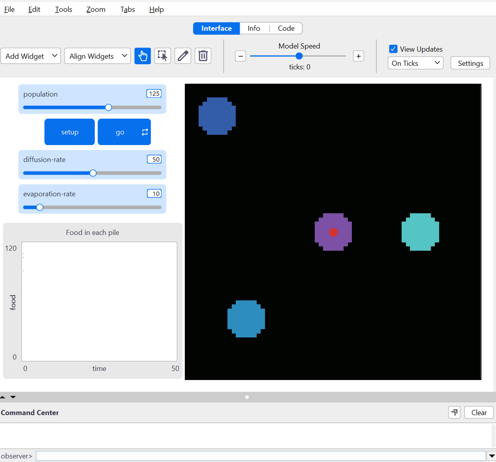
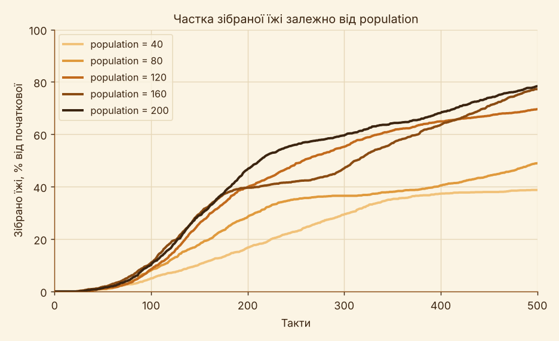
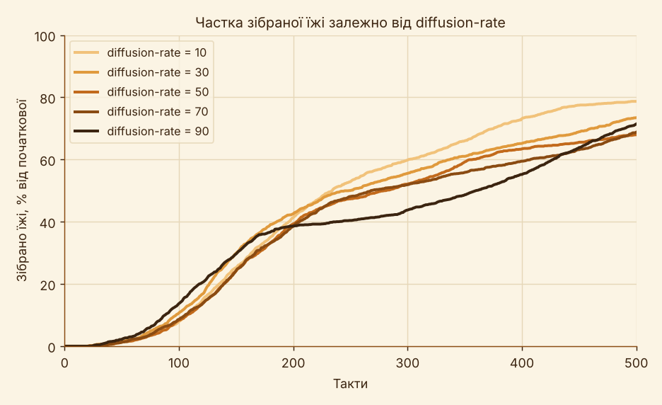
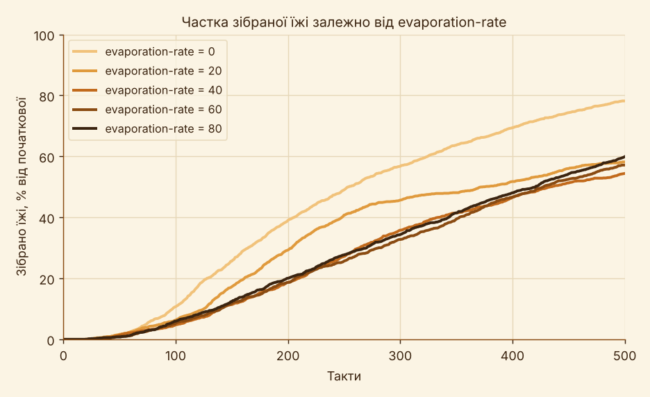

## Комп'ютерні системи імітаційного моделювання
## СПм-25-2, **Роскошний Владислав Русланович**
### Лабораторна робота №**1**. Опис імітаційних моделей та проведення обчислювальних експериментів

 

### Варіант 10, модель у середовищі NetLogo:
[Ants](http://www.netlogoweb.org/launch#http://www.netlogoweb.org/assets/modelslib/Sample%20Models/Biology/Ants.nlogo)

 

### Мета роботи:
Ознайомитися з моделлю Ants з бібліотеки моделей NetLogo, описати її та провести обчислювальні експерименти, що показують характер залежності показників роботи моделі від керуючих параметрів.

### Вербальний опис моделі:
Модель Ants з розділу Biology бібліотеки моделей NetLogo (автор - Uri Wilensky; експерименти виконано у NetLogo 7.0.4). Колонія мурах шукає їжу: кожна мураха діє за простими правилами, але колонія в цілому поводиться доцільно. У центрі поля розташоване гніздо (фіолетове), навколо нього - три купки їжі: праворуч, у лівому нижньому та лівому верхньому кутах. На кожній ділянці купки лежить 1 або 2 одиниці їжі (випадково).

Мураха, що знайшла їжу, несе одну одиницю до гнізда і залишає на шляху хімічну речовину (феромон). Інші мурахи відчувають її і йдуть за слідом до їжі, тим самим підсилюючи його. Феромон поступово розтікається по сусідніх ділянках та випаровується. Дорогу до гнізда мурахи знаходять за запахом гнізда, який сильніший біля нього.

Зміни стану моделі на кожному такті:
- на початку мурахи залишають гніздо не всі одразу: мураха з номером who починає рух лише з такту, що дорівнює цьому номеру;
- мураха без їжі (червона): якщо стоїть на ділянці з їжею, бере одну одиницю (змінює колір) і розвертається; інакше, якщо концентрація феромону на її ділянці від 0,05 до 2, повертає в той бік (прямо або на 45° праворуч чи ліворуч), де феромону більше;
- мураха з їжею: якщо вона в гнізді, залишає їжу, знову стає червоною і розвертається; інакше залишає на ділянці 60 одиниць феромону та повертає в той бік, де запах гнізда сильніший;
- далі мураха робить невеликий випадковий поворот (менше ніж на 40° праворуч і ліворуч), біля краю поля розвертається і робить крок уперед;
- наприкінці такту феромон розтікається, випаровується, і ділянки перефарбовуються (за концентрацією феромону або за кольором купки їжі).

  
*Рис. 1. Інтерфейс моделі Ants зі значеннями параметрів за замовчуванням.*

### Керуючі параметри:
- **population** - кількість мурах (від 0 до 200, за замовчуванням 125). Змінюється перед запуском setup.
- **diffusion-rate** - швидкість розтікання феромону по сусідніх ділянках (від 0 до 99, за замовчуванням 50).
- **evaporation-rate** - швидкість випаровування феромону (від 0 до 99, за замовчуванням 10).

### Внутрішні параметри:
- змінні ділянок: **chemical** (кількість феромону), **food** (їжа на ділянці: 0, 1 або 2), **nest?** (чи належить ділянка гнізду), **nest-scent** (запах гнізда, вищий ближче до гнізда), **food-source-number** (номер купки їжі: 1, 2 або 3);
- колір мурахи: червоний - без їжі, помаранчевий - з їжею;
- сталі в коді: гніздо та купки мають радіус 5 ділянок, мураха залишає 60 одиниць феромону, реагує на феромон у межах від 0,05 до 2, повертає на 45° при пошуку напряму.

### Показники роботи системи:
- графік Food in each pile: кількість їжі, що залишилась у кожній із трьох купок (food-in-pile1, food-in-pile2, food-in-pile3);
- кількість тактів модельного часу (ticks);
- концентрація феромону, що відображається зелено-білим градієнтом кольору ділянок.

### Примітки:
Згідно з описом моделі, колонія зазвичай збирає їжу по черзі, починаючи з найближчої купки: до віддалених купок стійкий слід утворити складніше, бо феромон встигає розтектися та випаруватися. Коли найближча купка вичерпана, її слід зникає, і мурахи переключаються на інші.

### Недоліки моделі:
- мурахи знаходять гніздо за глобальним запахом гнізда, який відомий у будь-якій точці поля, що є спрощенням (на це вказує й опис моделі);
- положення купок їжі та гнізда задано в коді і не регулюється з інтерфейсу;
- кількість мурах задається лише перед запуском і потім не змінюється: мурахи не з'являються і не гинуть;
- на інтерфейсі немає показника загальної кількості зібраної їжі, лише графік по купках, а кожна лінія графіка визначається за кольором ділянок (cyan, sky, blue), а не за номером купки;
- модель не зупиняється сама після збору всієї їжі.

 

## Обчислювальні експерименти
Усі експерименти виконано засобами BehaviorSpace: для кожного значення параметра - 5 повторів, ліміт - 500 тактів, показник записувався на кожному такті. Результати збережено у файлах `e1.csv`, `e2.csv`, `e3.csv`.

**Показник.** Основним показником є кількість їжі, що лишилася на полі, - сума значень трьох ліній графіка Food in each pile. Початкова кількість їжі в різних прогонах різна (від 290 до 323 одиниць, бо на кожній ділянці купки 1 або 2 одиниці випадково), тому для порівняння використано також **частку зібраної їжі**: (початкова кількість - залишок на 500-му такті) / початкова кількість, у відсотках. У жодному прогоні всю їжу за 500 тактів зібрано не було.

### 1. Вплив кількості мурах на збір їжі
Досліджується залежність частки зібраної їжі за 500 тактів від **population**. Значення: 40, 80, 120, 160, 200, по 5 повторів, усього 25 симуляцій.  
Інші керуючі параметри мають такі значення:
- **diffusion-rate**: 50
- **evaporation-rate**: 10

| population | Залишок їжі на 500-му такті, середнє | Зібрано їжі, % (середнє) | Стандартне відхилення, в. п. | Мін - макс, % | Прогонів із зібраними 50 % і більше (із 5) |
|---|---|---|---|---|---|
| 40 | 189,8 | 38,8 | 2,2 | 36,7 - 41,2 | 0 |
| 80 | 156,2 | 49,0 | 5,3 | 42,4 - 55,6 | 3 |
| 120 | 94,4 | 69,6 | 4,2 | 64,1 - 75,4 | 5 |
| 160 | 70,4 | 77,3 | 6,0 | 71,4 - 84,9 | 5 |
| 200 | 67,8 | 78,4 | 8,4 | 68,6 - 88,7 | 5 |

  
*Рис. 2. Середня за 5 прогонів частка зібраної їжі залежно від такту для різних значень population.*

При 40 мурахах за 500 тактів збирається в середньому 38,8 % їжі, і в жодному з п'яти прогонів не досягнуто 50 %. Зі збільшенням кількості мурах до 80 та 120 частка зростає до 49,0 та 69,6 %. Далі приріст сповільнюється: 77,3 % при 160 і 78,4 % при 200. Різниця між 160 та 200 (1,1 в. п.) значно менша за розкид повторів при 200 (від 68,6 до 88,7 %), тому відрізнити ці два значення за 5 повторів надійно не вдалося.

### 2. Вплив швидкості розтікання феромону на збір їжі
Досліджується залежність частки зібраної їжі за 500 тактів від **diffusion-rate**. Значення: 10, 30, 50, 70, 90, по 5 повторів, усього 25 симуляцій.  
Інші керуючі параметри мають такі значення:
- **population**: 125
- **evaporation-rate**: 10

| diffusion-rate | Залишок їжі на 500-му такті, середнє | Зібрано їжі, % (середнє) | Стандартне відхилення, в. п. | Мін - макс, % | Прогонів із зібраними 50 % і більше (із 5) |
|---|---|---|---|---|---|
| 10 | 65,6 | 78,7 | 5,5 | 72,3 - 85,4 | 5 |
| 30 | 81,8 | 73,5 | 4,4 | 68,9 - 80,4 | 5 |
| 50 | 99,2 | 68,0 | 4,2 | 61,3 - 71,7 | 5 |
| 70 | 98,0 | 68,8 | 6,1 | 58,8 - 74,6 | 5 |
| 90 | 87,6 | 71,4 | 2,4 | 69,1 - 74,8 | 5 |

  
*Рис. 3. Середня за 5 прогонів частка зібраної їжі залежно від такту для різних значень diffusion-rate.*

При diffusion-rate = 10 зібрано в середньому 78,7 % їжі (від 72,3 до 85,4 %), що найбільше з п'яти значень. При 30 - 73,5 %, при 50, 70 та 90 - 68,0, 68,8 та 71,4 %. Діапазони сусідніх значень перекриваються (наприклад, 68,9 - 80,4 % при 30 і 61,3 - 71,7 % при 50), тому чіткої монотонної залежності за 5 повторів не видно. Можна лише відзначити, що найменше значення diffusion-rate дало найкращий результат у середньому.

### 3. Вплив швидкості випаровування феромону на збір їжі
Досліджується залежність частки зібраної їжі за 500 тактів від **evaporation-rate**. Значення: 0, 20, 40, 60, 80, по 5 повторів, усього 25 симуляцій.  
Інші керуючі параметри мають такі значення:
- **population**: 125
- **diffusion-rate**: 50

| evaporation-rate | Залишок їжі на 500-му такті, середнє | Зібрано їжі, % (середнє) | Стандартне відхилення, в. п. | Мін - макс, % | Прогонів із зібраними 50 % і більше (із 5) |
|---|---|---|---|---|---|
| 0 | 67,2 | 78,2 | 4,1 | 74,8 - 82,8 | 5 |
| 20 | 130,0 | 58,2 | 12,5 | 48,2 - 73,2 | 3 |
| 40 | 141,0 | 54,4 | 4,1 | 50,0 - 59,5 | 5 |
| 60 | 132,6 | 57,1 | 3,6 | 52,6 - 62,3 | 5 |
| 80 | 122,8 | 59,9 | 2,6 | 57,2 - 63,7 | 5 |

  
*Рис. 4. Середня за 5 прогонів частка зібраної їжі залежно від такту для різних значень evaporation-rate.*

Без випаровування (0) зібрано в середньому 78,2 % їжі (від 74,8 до 82,8 %). Вже при 20 середнє падає до 58,2 %, причому розкид великий: у двох прогонах зібрано понад 70 %, а в трьох - від 48,2 до 50,8 %. При 40, 60 та 80 середні значення становлять 54,4, 57,1 та 59,9 %, їхні діапазони перекриваються, тому тенденцію між цими значеннями стверджувати не можна. При цьому жоден прогін із evaporation-rate від 20 і вище не досяг результату, отриманого без випаровування (74,8 % і більше). Це узгоджується з ідеєю моделі, що феромонні сліди допомагають збирати їжу, а їх швидке випаровування цьому заважає; цей механізм окремо не перевіряли.

 

### Висновки:
У ході роботи описано модель Ants, її параметри та показники, виконано три обчислювальні експерименти по 5 повторів на кожне значення параметра. Кількість мурах дає найбільшу зміну результату: від 38,8 % при 40 мурахах до 77,3-78,4 % при 160-200, після чого приріст майже зникає. Перехід від відсутності випаровування феромону до будь-якого ненульового значення знижує частку зібраної їжі приблизно на 20,0 в. п. між evaporation-rate = 0 і 20. Вплив diffusion-rate за 5 повторів виявився слабким і неоднозначним. За 500 тактів усю їжу не було зібрано в жодному прогоні, а початкова кількість їжі випадкова, тому оцінки наближені.
