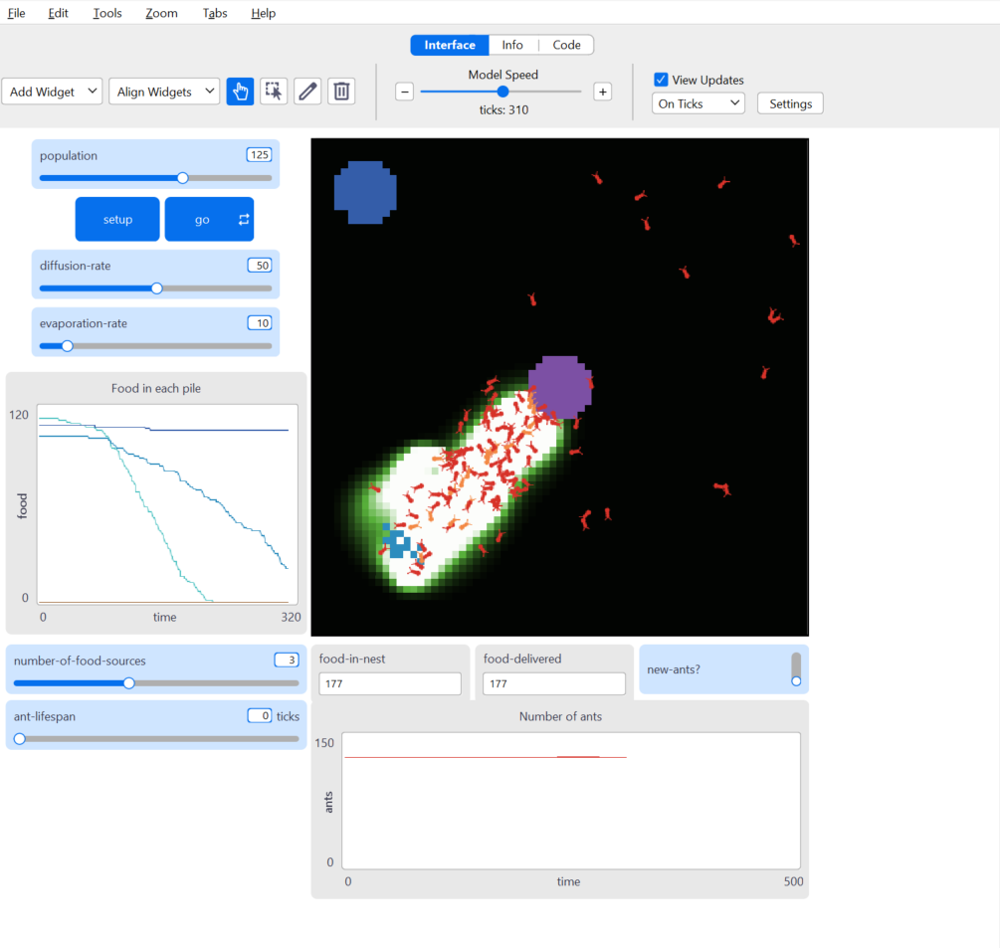
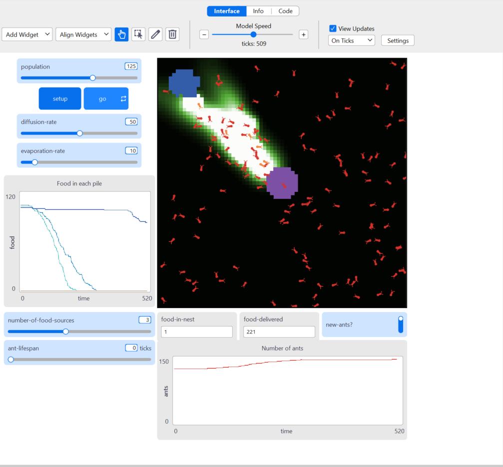
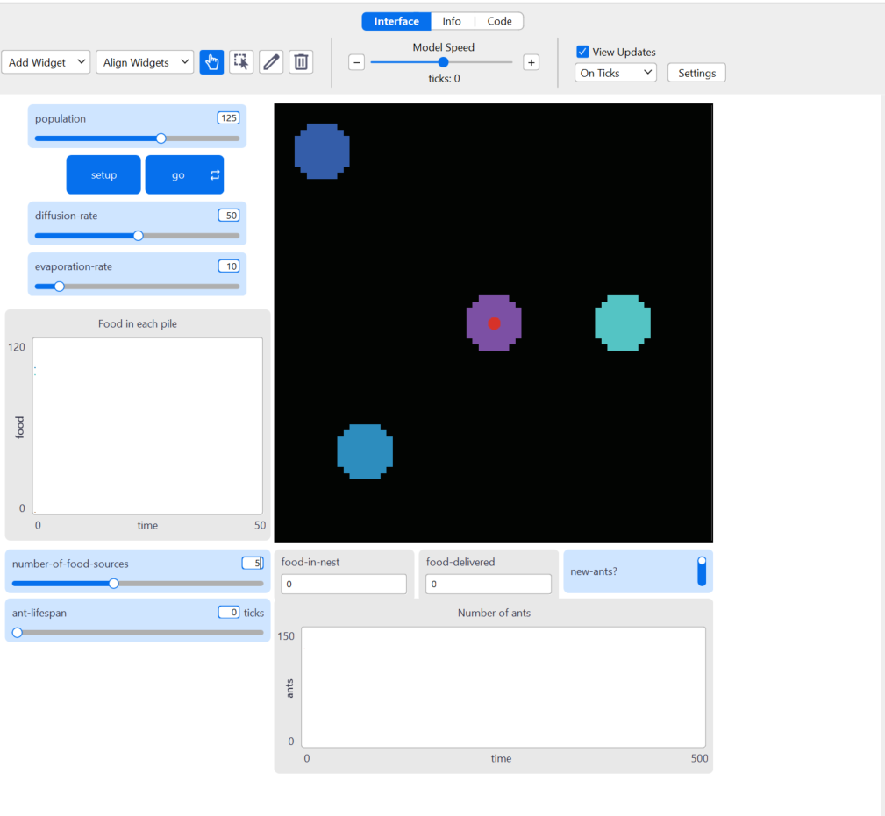
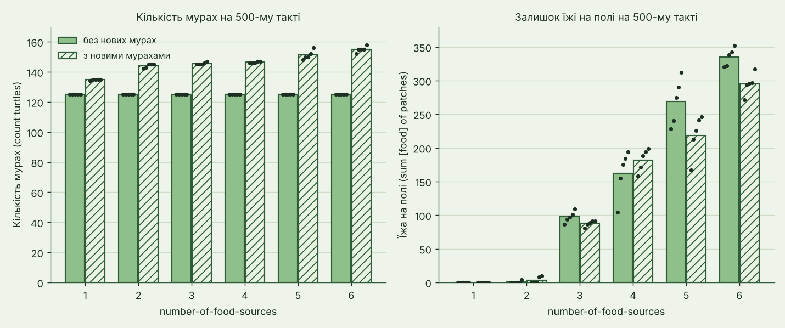

## Комп'ютерні системи імітаційного моделювання
## СПм-25-2, **Роскошний Владислав Русланович**
### Лабораторна робота №**2**. Редагування імітаційних моделей у середовищі NetLogo

<br>

### Варіант 10, модель у середовищі NetLogo:
[Ants](http://www.netlogoweb.org/launch#http://www.netlogoweb.org/assets/modelslib/Sample%20Models/Biology/Ants.nlogo)

<br>

### Внесені зміни у вихідну логіку моделі, за варіантом:

**Кількість джерел їжі** - у вихідній моделі на полі завжди три джерела їжі в жорстко заданих місцях. Додано слайдер `number-of-food-sources` (від 1 до 6, за замовчуванням 3). Центри можливих джерел зберігаються у списку `food-source-centers` (частки розміру світу), перші три збігаються з оригінальними, ще три додано в інших частинах поля. Джерело отримують перші `number-of-food-sources` центрів. Для джерел 4-6 додано кольори (жовтий, рожевий, коричневий) і лінії на графіку Food in each pile.
```netlogo
;; було
to setup-food  ;; patch procedure
  ;; setup food source one on the right
  if (distancexy (0.6 * max-pxcor) 0) < 5
  [ set food-source-number 1 ]
  ;; setup food source two on the lower-left
  if (distancexy (-0.6 * max-pxcor) (-0.6 * max-pycor)) < 5
  [ set food-source-number 2 ]
  ;; setup food source three on the upper-left
  if (distancexy (-0.8 * max-pxcor) (0.8 * max-pycor)) < 5
  [ set food-source-number 3 ]
  ;; set "food" at sources to either 1 or 2, randomly
  if food-source-number > 0
  [ set food one-of [1 2] ]
end

;; стало
to setup-food  ;; patch procedure
  let n 1
  foreach food-source-centers [ c ->
    if n <= number-of-food-sources and
       (distancexy ((item 0 c) * max-pxcor) ((item 1 c) * max-pycor)) < 5
    [ set food-source-number n ]
    set n n + 1 ]
  ;; set "food" at sources to either 1 or 2, randomly
  if food-source-number > 0
  [ set food one-of [1 2] ]
end
```
Список центрів задається в `setup`:
```netlogo
set food-source-centers [ [0.6 0] [-0.6 -0.6] [-0.8 0.8] [0.6 0.8] [0.2 -0.8] [-0.8 0] ]
```

**Показник кількості їжі в гнізді** - додано глобальні змінні `food-in-nest` (запас їжі в гнізді, що витрачається на нових мурах) та `food-delivered` (скільки їжі принесено в гніздо за весь час), обидві показуються користувачеві у двох моніторах під полем моделі. Обидва лічильники збільшуються на 1, коли мураха кладе їжу в гнізді.
```netlogo
;; було
to return-to-nest  ;; turtle procedure
  ifelse nest?
  [ ;; drop food and head out again
    set color red
    rt 180 ]
  ...

;; стало
to return-to-nest  ;; turtle procedure
  ifelse nest?
  [ ;; drop food and head out again
    set food-in-nest food-in-nest + 1
    set food-delivered food-delivered + 1
    set color red
    rt 180 ]
  ...
```

**Відключаєма поява нових мурах** - додано перемикач `new-ants?` (за замовчуванням вимкнений) та внутрішній параметр `ant-cost` = 10 (задається в `setup`). Якщо перемикач увімкнений і в гнізді є щонайменше `ant-cost` їжі, на кожному такті не більше однієї нової мурахи: запас зменшується на `ant-cost`, у гнізді з'являється нова мураха (червона, тобто без їжі).
```netlogo
;; додано в go, перед diffuse chemical
if new-ants? and food-in-nest >= ant-cost
[ set food-in-nest food-in-nest - ant-cost
  create-turtles 1
  [ set size 2
    set color red ] ]
```
Оскільки їжа на полі скінченна, кількість нових мурах обмежена: за прогон їх народжується не більше, ніж `food-delivered / ant-cost`.

**Графік зміни кількості мурах** - додано графік Number of ants з пером, що на кожному такті малює `count turtles`:
```netlogo
plotxy ticks count turtles
```

<br>

### Внесені зміни у вихідну логіку моделі, на власний розсуд:

**Смертність мурах.** У вихідній моделі мурахи живуть вічно. Додано слайдер `ant-lifespan` (від 0 до 1000 тактів, крок 50, за замовчуванням 0): мураха, вік якої (змінна `age`, збільшується на 1 щотакту) перевищує це значення, помирає. При 0 смертність вимкнена і логіка вихідної моделі не порушується. Мураха, що померла, несучи їжу, втрачає її.
```netlogo
;; додано на початку go
ask turtles [ set age age + 1 ]
if ant-lifespan > 0 [ ask turtles with [ age > ant-lifespan ] [ die ] ]
```
Вплив смертності в експерименті нижче не досліджувався (у всіх прогонах `ant-lifespan` = 0).

На рис. 1 і 2 показано роботу моделі зі стандартними трьома джерелами при вимкненому та увімкненому `new-ants?`, на рис. 3 - стан після setup при `number-of-food-sources` = 5.

  
*Рис. 1. Модель при вимкненому `new-ants?` (такт 310): у гнізді накопичено 177 одиниць їжі, `food-in-nest` = `food-delivered`, кількість мурах на графіку Number of ants стала (125).*

  
*Рис. 2. Модель при увімкненому `new-ants?` (такт 509): `food-delivered` = 221, `food-in-nest` = 1, кількість мурах на графіку зросла зі 125 до приблизно 150.*

  
*Рис. 3. Стан після setup при `number-of-food-sources` = 5: на полі п'ять джерел їжі.*

Фінальний код моделі та її інтерфейс доступні за посиланням: [Ants.nlogox](Ants.nlogox).

<br>

## Обчислювальний експеримент
### 1. Вплив кількості джерел їжі та появи нових мурах
Досліджується, як залежать від **number-of-food-sources** кількість мурах і залишок їжі на полі на 500-му такті, та як на цю залежність впливає відключаєма поява нових мурах `new-ants?`. Експеримент `lw2_ants` виконано засобами BehaviorSpace: number-of-food-sources = 1, 2, 3, 4, 5, 6; `new-ants?` вимкнено та увімкнено; по 5 повторів, усього 60 симуляцій, ліміт 500 тактів. Результати збережено у файлі `Ants_lw2_ants-table.csv`.  
Інші керуючі параметри мають такі значення:
- **population**: 125
- **diffusion-rate**: 50
- **evaporation-rate**: 10
- **ant-lifespan**: 0

Показниками є кількість мурах (`count turtles`) та залишок їжі на полі (`sum [food] of patches`) на 500-му такті. Початкова кількість їжі в кожному прогоні випадкова (кожна клітинка джерела містить 1 або 2 одиниці), тому залишок їжі порівнюється лише між варіантами з однаковою кількістю джерел.

| number-of-food-sources | Мурахи без нових (середнє) | Мурахи з новими: середнє | Мурахи з новими: мін - макс | Залишок їжі без нових: середнє | Залишок їжі без нових: мін - макс | Залишок їжі з новими: середнє | Залишок їжі з новими: мін - макс |
|---|---|---|---|---|---|---|---|
| 1 | 125 | 134,8 | 134 - 135 | 0,0 | 0 - 0 | 0,0 | 0 - 0 |
| 2 | 125 | 144,0 | 142 - 145 | 0,8 | 0 - 4 | 3,6 | 0 - 10 |
| 3 | 125 | 145,6 | 145 - 147 | 97,4 | 86 - 109 | 87,6 | 81 - 91 |
| 4 | 125 | 146,4 | 146 - 147 | 162,4 | 104 - 194 | 182,0 | 158 - 199 |
| 5 | 125 | 151,2 | 148 - 156 | 269,0 | 228 - 312 | 218,6 | 167 - 246 |
| 6 | 125 | 155,0 | 152 - 158 | 334,8 | 320 - 352 | 294,8 | 271 - 317 |

  
*Рис. 4. Середні значення (стовпці) та результати окремих прогонів (точки) на 500-му такті для вимкнених і увімкнених нових мурах.*

**Кількість мурах.** Без нових мурах вона у всіх прогонах дорівнює 125. З новими мурахами кількість зростає разом із кількістю джерел: за кількістю нових мурах (різниця з 125) 9,8 при 1 джерелі, 19,0 при 2, 20,6 при 3, 21,4 при 4, 26,2 при 5 і 30,0 при 6 джерелах. Зростання нерівномірне: між 2, 3 та 4 джерелами різниця невелика (19,0, 20,6 та 21,4), а при 5 і 6 джерелах стає помітнішою. Це узгоджується з тим, що більше джерел означає більше їжі, яку можна принести в гніздо та перетворити на мурах.

**Залишок їжі.** При 1 джерелі всю їжу зібрано в усіх 10 прогонах (залишок 0), при 2 джерелах залишок мізерний (0,8 без нових мурах і 3,6 з новими). Починаючи з 3 джерел частина їжі лишається на полі, і залишок швидко зростає з кількістю джерел: від 97,4 при 3 до 334,8 при 6 без нових мурах. Тобто за 500 тактів 125 мурах не встигають зібрати їжу з усіх джерел. З новими мурахами залишок при 3, 5 і 6 джерелах менший (87,6, 218,6 і 294,8 проти 97,4, 269,0 і 334,8), але діапазони результатів перекриваються при 3 і 5 джерелах, а при 4 джерелах середнє навіть більше (182,0 проти 162,4). Чітко розділені діапазони лише при 6 джерелах (271 - 317 проти 320 - 352). Тому стверджувати, що нові мурахи прискорюють збір їжі, за 5 повторів можна лише для 6 джерел.

<br>

### Висновки:
У модель Ants внесено зміни за варіантом: слайдер кількості джерел їжі (1-6), монітори їжі в гнізді, відключаєма поява нових мурах і графік кількості мурах, а також власну зміну - смертність мурах (`ant-lifespan`). При вимкнених нових мурахах і нульовій смертності модель поводиться як вихідна. В експерименті з 60 симуляцій показано, що кількість нових мурах зростає з кількістю джерел: від 9,8 при 1 джерелі до 30,0 при 6. Залишок їжі на полі до 500-го такту з кількістю джерел помітно зростає: від практично 0 при 1-2 джерелах до 334,8 при 6 без нових мурах. Помітний вплив нових мурах на залишок їжі підтверджено лише при 6 джерелах. Вплив `ant-lifespan` на показники не досліджувався. Через малу кількість повторів (5) отримані оцінки наближені.
