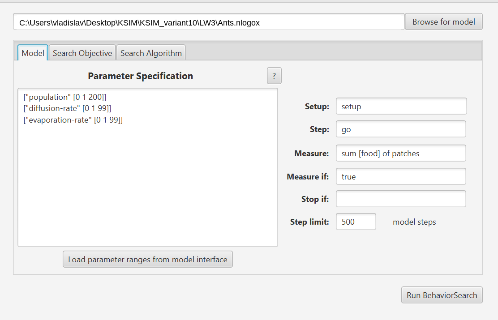
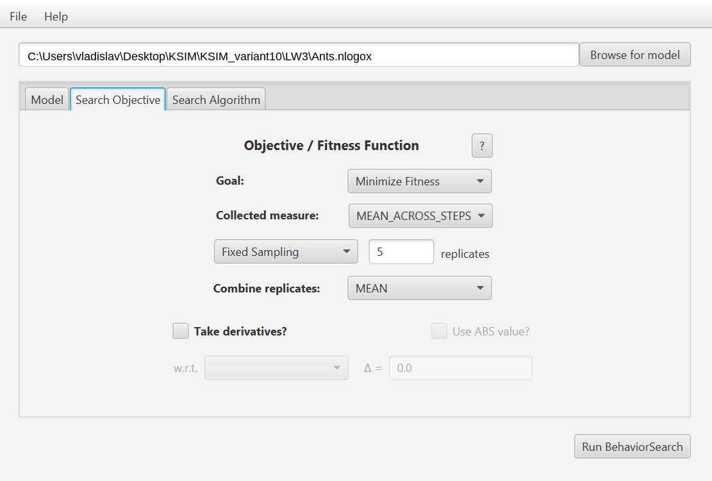
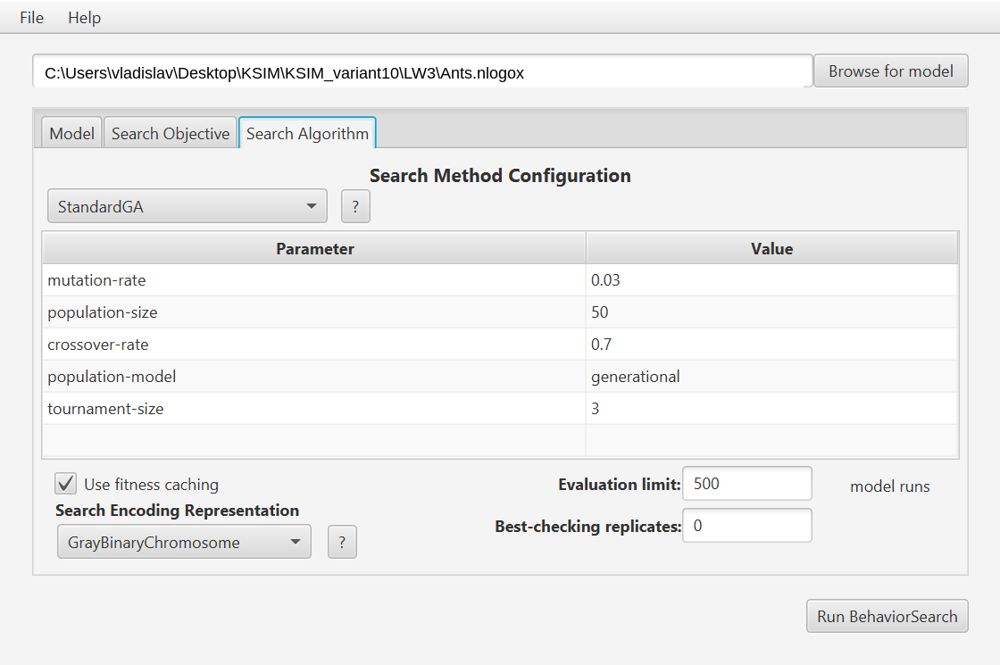
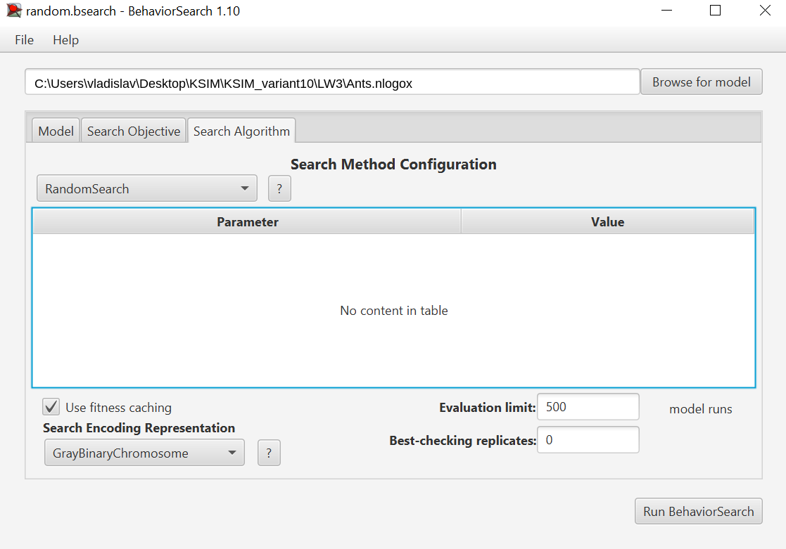
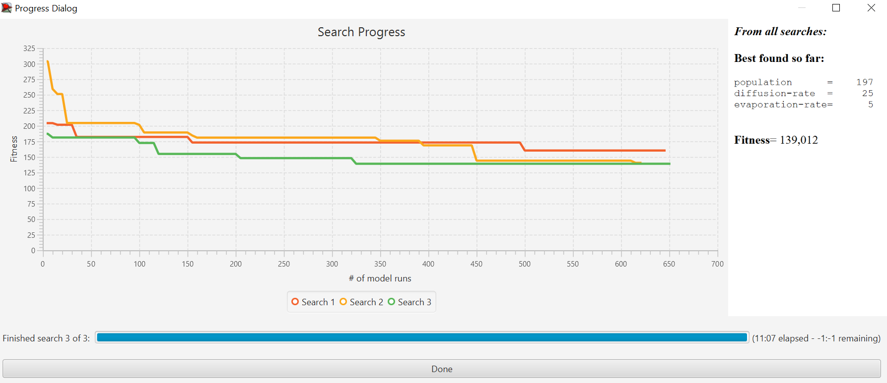
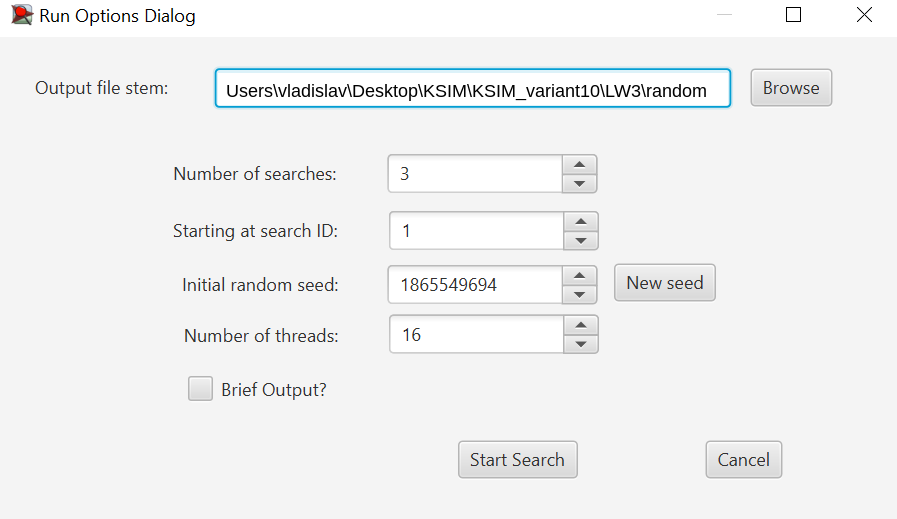
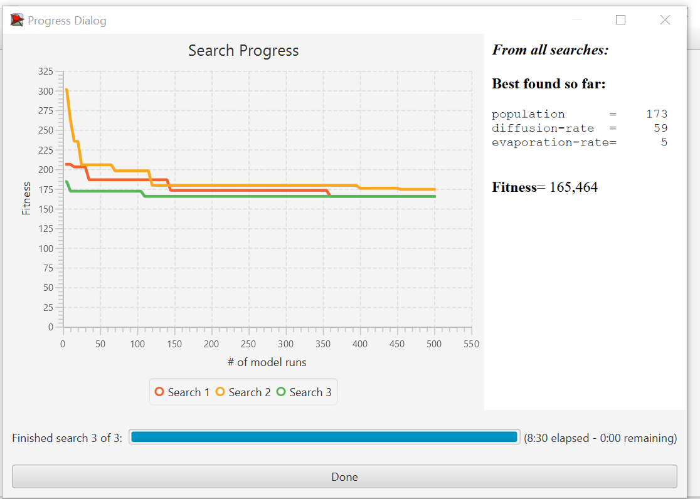
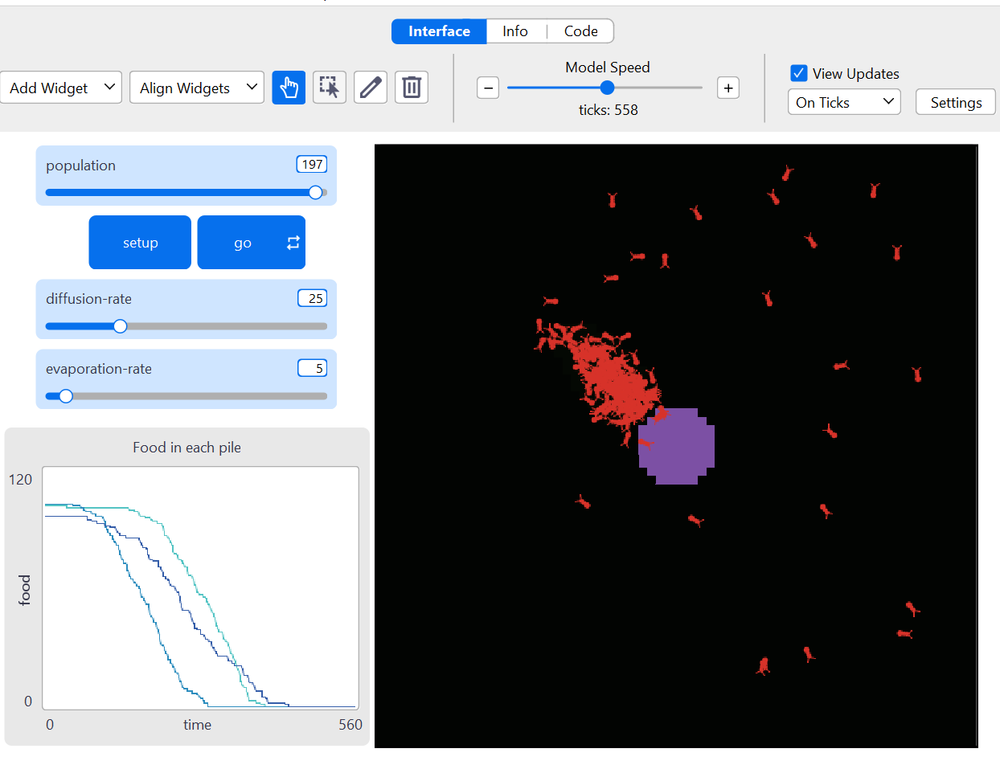

## Комп'ютерні системи імітаційного моделювання
## СПм-25-2, **Роскошний Владислав Русланович**
### Лабораторна робота №**3**. Використання засобів обчислювального інтелекту для оптимізації імітаційних моделей

 

### Варіант 10, модель у середовищі NetLogo:
[Ants](http://www.netlogoweb.org/launch#http://www.netlogoweb.org/assets/modelslib/Sample%20Models/Biology/Ants.nlogo)

 

#### Вербальний опис моделі:
Опис моделі, її параметрів та показників наведено в [першій лабораторній роботі](../LW1/LW1.md). У цій роботі використано базову версію моделі Ants без змін.

 

### Налаштування середовища BehaviorSearch:

**Обрана модель**: [Ants.nlogox](Ants.nlogox) з цього каталогу (версія NetLogo 7.0.4, BehaviorSearch 1.10).

**Параметри моделі** (вкладка Model):
<pre>
["population" [0 1 200]]
["diffusion-rate" [0 1 99]]
["evaporation-rate" [0 1 99]]
</pre>
Діапазони відповідають слайдерам інтерфейсу моделі. Змінюються всі три параметри: population (кількість мурах), diffusion-rate (швидкість розсіювання феромону) та evaporation-rate (швидкість його випаровування).

Використовувана **міра**:
<pre>
sum [food] of patches
</pre>
Міра - сумарна кількість їжі, що лишилася на карті. Вона обрана тому, що мета мурах - перенести їжу в гніздо, тобто чим швидше зменшується ця величина, тим ефективніше працює колонія. Тому мета пошуку - **мінімізувати** міру. Інші параметри вкладки: Setup - `setup`, Step - `go`, Measure if - `true`, Stop if - порожньо (модель сама не зупиняється, прогін обмежено лімітом), Step limit - 500 тактів.  

**Налаштування цільової функції** (вкладка Search Objective):  
Goal: **Minimize Fitness**. Collected measure: **MEAN_ACROSS_STEPS**, тобто береться середнє значення міри за всі такти прогону. Значення на останньому такті не підходить, бо для багатьох наборів параметрів увесь запас їжі виявляється зібраним і воно було б однаковим (0), а середнє за всі такти враховує ще й швидкість збору. Щоб зменшити вплив випадковості, кожен варіант параметрів перевіряється **5 разів** (Fixed Sampling, 5 replicates), результат - **середнє арифметичне** (Combine replicates: MEAN).  

**Налаштування алгоритму пошуку** (вкладка Search Algorithm):  
Для обох алгоритмів Evaluation limit = **500**, кодування - GrayBinaryChromosome, Use fitness caching увімкнено, Best-checking replicates = 0. Налаштування збережено у файлах [ga.bsearch](ga.bsearch) та [random.bsearch](random.bsearch).
- **StandardGA** (простий генетичний алгоритм) - параметри за замовчуванням: mutation-rate 0,03; population-size 50; crossover-rate 0,7; population-model generational; tournament-size 3.
- **RandomSearch** (випадковий пошук) - власних параметрів не має.

Вкладка Search Algorithm для генетичного алгоритму:  

Вкладка Search Algorithm для випадкового пошуку:  

 

### Результати використання BehaviorSearch:
Кожен алгоритм запускався тричі (Number of searches: 3). Дані взято з файлів `ga.finalBests.csv` та `random.finalBests.csv`, повні історії пошуку - у решті CSV-файлів цього каталогу.

Діалогове вікно запуску пошуку генетичним алгоритмом:  

Результат пошуку параметрів за допомогою **генетичного алгоритму**:  

| Пошук | population | diffusion-rate | evaporation-rate | Fitness | Запусків моделі до кінця пошуку |
|---|---|---|---|---|---|
| 1 | 184 | 18 | 10 | 160,29 | 645 |
| 2 | 175 | 27 | 3 | 140,47 | 620 |
| 3 | 197 | 25 | 5 | 139,01 | 650 |

Діалогове вікно запуску випадкового пошуку:  

Результат **випадкового пошуку**:  

| Пошук | population | diffusion-rate | evaporation-rate | Fitness | Запусків моделі до кінця пошуку |
|---|---|---|---|---|---|
| 1 | 194 | 58 | 0 | 165,49 | 500 |
| 2 | 91 | 6 | 2 | 174,42 | 500 |
| 3 | 173 | 59 | 5 | 165,46 | 500 |

### Порівняння алгоритмів:
Fitness - це середня за 500 тактів кількість їжі, що лишилася на карті, тому менше значення краще. Найкращий результат дав генетичний алгоритм (пошук 3): fitness 139,01 при population 197, diffusion-rate 25, evaporation-rate 5. У випадкового пошуку найкращий результат 165,46 (population 173, diffusion-rate 59, evaporation-rate 5), тобто на 26,45 одиниці (близько 16 %) гірший.

Перевага ГА стабільна: середній найкращий fitness дорівнює 146,59 для ГА (від 139,01 до 160,29) проти 168,46 для випадкового пошуку (від 165,46 до 174,42). Кожен із трьох результатів ГА кращий за будь-який з трьох результатів випадкового пошуку. Обидва алгоритми знайшли схожі за змістом налаштування: велика кількість мурах (population 173-197 у найкращих результатах, крім пошуку 2 випадкового алгоритму, де population 91) і низьке випаровування феромону (evaporation-rate 0-10). Значення diffusion-rate сильно відрізняються (від 6 до 59), тому цей параметр у даній постановці менш визначальний, ніж два інші.

Швидкість: за часом три пошуки ГА зайняли 11:07, випадкового пошуку - 8:30 (за вікнами прогресу). У ГА остання перевірка припала на 620-650-й запуск, тобто більше за ліміт 500, у випадкового пошуку рівно 500. Останнє покращення в ГА відбулося на 500, 615 та 325-му запусках (пошуки 1, 2, 3), у випадкового пошуку - на 360, 455 та 110-му. Тобто ГА витратив на 30 % більше часу, але знайшов суттєво кращі параметри.

### Перевірка знайдених параметрів у NetLogo:
У NetLogo виставлено параметри, знайдені генетичним алгоритмом (пошук 3): population 197, diffusion-rate 25, evaporation-rate 5, після чого виконано `setup` та запущено `go`. Модель працює коректно: на 558-му такті на графіку Food in each pile усі три криві (запас їжі в кожній з трьох куп) спадають до нуля, тобто всю їжу перенесено в гніздо. Найбільше мурах зосереджено біля гнізда (фіолетове коло), що відповідає великій кількості мурах і слабкому випаровуванню феромону.  
  
*Рис. 1. Модель Ants із параметрами, знайденими генетичним алгоритмом (такт 558).*
